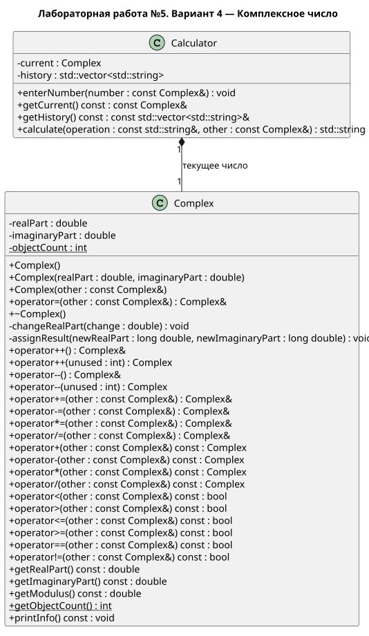
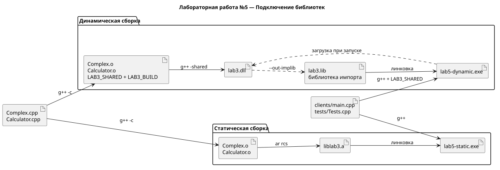

# Лабораторная работа №5

Вариант 4 — Комплексное число

Статическая и динамическая библиотеки на основе третьей лабораторной работы. Стандарт языка — C++14, компилятор — MinGW-w64 g++ для Windows x64

В эту папку скопированы Complex, Calculator и проверки из лабораторной №3. Исходная папка lab3 не изменяется и для сборки не нужна

## Что сделано

У каждого класса отдельные файлы объявления и реализации. В заголовки добавлен макрос экспорта и импорта для DLL

Из Complex.cpp и Calculator.cpp собираются две библиотеки. Файлы clients/main.cpp и tests/Tests.cpp используются в обоих клиентах без изменений. Клиенты отличаются способом линковки

| Файл после сборки | Назначение |
| --- | --- |
| build/static/liblab3.a | Статическая библиотека с реализацией классов |
| build/static/lab5-static.exe | Клиент статической библиотеки |
| build/shared/lab3.dll | Динамическая библиотека с реализацией классов |
| build/shared/lab3.lib | Библиотека импорта для DLL, созданная MinGW |
| build/shared/lab5-dynamic.exe | Клиент динамической библиотеки |

## Сборка и запуск

Нужен MinGW-w64 UCRT64: g++, ar и objdump в PATH. Все компоненты собираются прямыми командами компилятора и архиватора из build.bat. Make, CMake и Ninja не используются

```powershell
.\build.bat
.\build\static\lab5-static.exe
.\build\shared\lab5-dynamic.exe
```

Обе программы запускают один калькулятор. Можно ввести комплексное число, выполнить операцию, посмотреть историю и выйти через пункт 0

DLL lab3.dll должна оставаться рядом с lab5-dynamic.exe. При переносе нужно копировать всю папку build/shared. Для статического клиента достаточно папки build/static

Сборка копирует необходимые библиотеки среды MinGW рядом с обоими exe. Статическая линковка в этой работе относится к нашей библиотеке lab3, а стандартная библиотека C++ подключается динамически

Автоматические проверки классов и калькулятора:

```powershell
.\build\static\lab5-static.exe --test
.\build\shared\lab5-dynamic.exe --test
```

Сравнение работы клиентов и их зависимостей через PowerShell 7:

```powershell
pwsh -File .\tests\verify.ps1
```

## Документация

- [Требования](pages/requirements.md)
- [Устройство программы](pages/design.md)
- [Ручная сборка](pages/build.md)
- [Результат работы](pages/result.md)
- [Диаграмма классов](uml/classes.puml)
- [Схема подключения библиотек](uml/libraries.puml)





Для создания HTML нужен Doxygen в PATH:

```powershell
.\docs.bat
```

Открыть docs/html/index.html. UML создается локально через PlantUML:

```powershell
java -jar plantuml.jar -tsvg uml/classes.puml uml/libraries.puml
```
